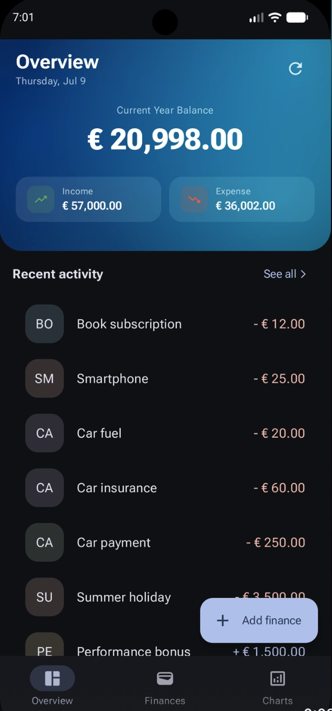
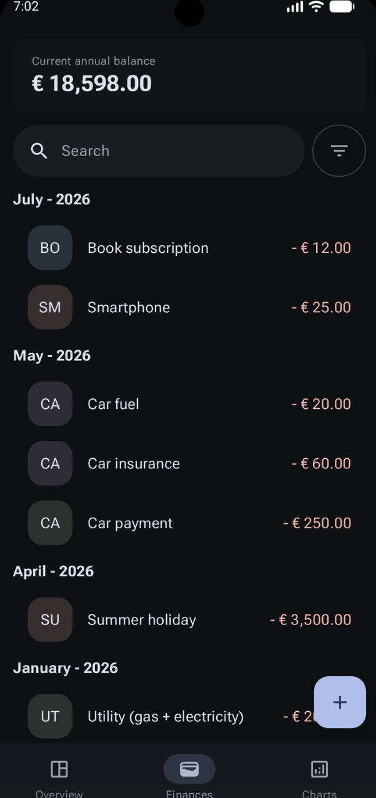
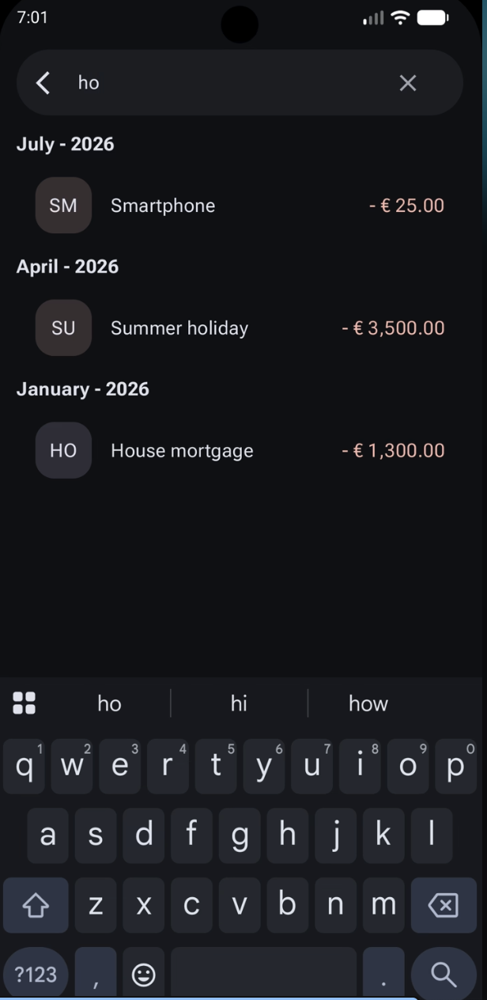
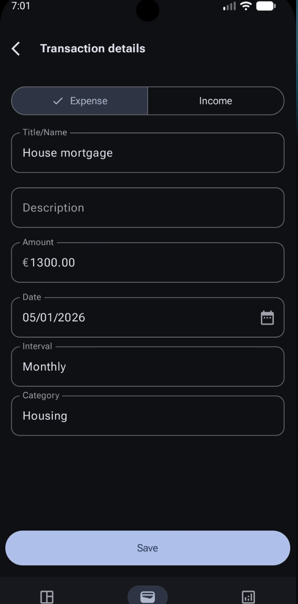
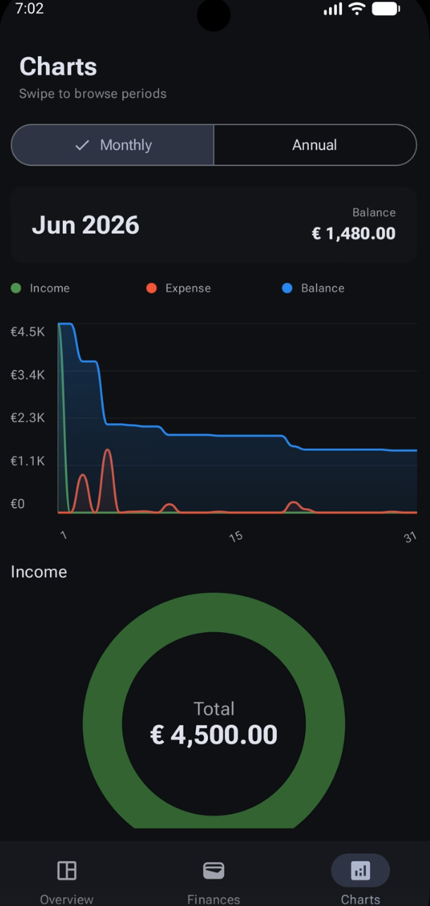
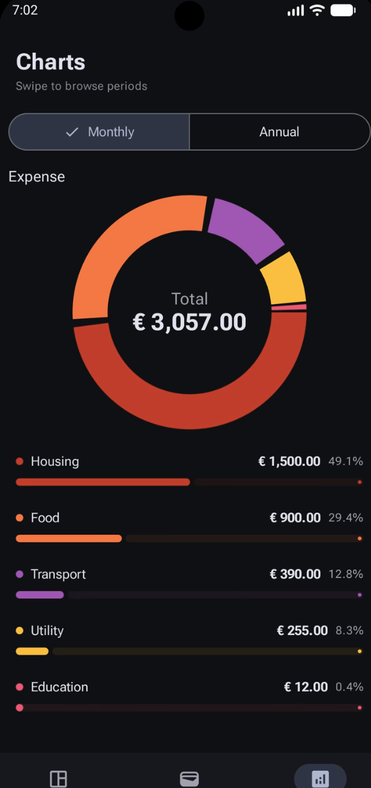

# FinanceFlow — Personal Finance & Budgeting App

**FinanceFlow** is a modern, native Android personal finance and budgeting application built with **Jetpack Compose** following **Material Design 3 Expressive** guidelines. Designed with an offline-first architecture, FinanceFlow helps users seamlessly track incomes, expenses, analyze spending trends through interactive charts, and gain full control over their financial health.

---

## 📸 Screenshots

| Home Dashboard | Transactions List | Search & Filter |
| :---: | :---: | :---: |
|  |  |  |

| Add / Edit Transaction | Line Chart Analytics | Category Pie Chart |
| :---: | :---: | :---: |
|  |  |  |

---

## ✨ Key Features

- 📊 **Financial Dashboard**: Overview of net balance, total income, total expenses, and cash flow proportion progress bar.
- 💳 **Transaction Tracking**: Add, edit, and manage income and expense transactions with amount, category, date, and notes.
- 🔍 **Advanced Filtering & Search**: Filter transactions by type (Income/Expense), category, date ranges, and custom keyword search.
- 📈 **Interactive Analytics & Charts**:
  - **Line Charts**: Track income and expense trends over custom time intervals (Weekly, Monthly, Yearly).
  - **Pie Charts**: Visual category-wise breakdown of spending and earnings.
- 🎨 **Material Design 3 Expressive**: Modern typography, custom gradients, smooth transitions, and intuitive touch targets.
- ⚡ **Offline-First & Local Storage**: Fast, privacy-focused local database persistence powered by Room.

---

## 🛠️ Tech Stack & Architecture

FinanceFlow adheres to modern Android development best practices and Clean Architecture principles:

- **UI Framework**: [Jetpack Compose](https://developer.android.com/jetpack/compose) with Material Design 3 Expressive (`material3-android`)
- **Navigation**: [Jetpack Navigation 3](https://developer.android.com/guide/navigation/navigation-3) (`navigation3-runtime`, `navigation3-ui`) with type-safe `NavKey` back stacks
- **Architecture**: Clean Architecture (Domain, Data, Presentation) + MVI (State, Action, Event)
- **Dependency Injection**: [Koin](https://insert-koin.io/) (`koin-android`, `koin-androidx-compose`)
- **Database & Persistence**: [Room](https://developer.android.com/training/data-storage/room) with [KSP](https://kotlinlang.org/docs/ksp-overview.html)
- **Charts & Data Visualization**: [Compose Charts](https://github.com/ehsannarmani/compose-charts)
- **Dates & Time**: `kotlinx-datetime`
- **Language**: Kotlin 2.2+ with KotlinX Serialization

---

## 📁 Project Architecture & Layout

```text
app/src/main/java/com/jd/financeflow/
├── di/                        # Koin Dependency Injection modules
├── features/
│   ├── core/                  # Shared domain, presentation components, and utilities
│   │   ├── domain/            # Error types and Result wrappers
│   │   └── presentation/      # UI components (TextFields, Avatars, Gradients)
│   ├── finance/
│   │   ├── data/              # Room Entity, DAO, Local Storage Data Source, Repository
│   │   ├── domain/            # Financial models (Finance, Category, Interval) & Repo Interface
│   │   └── presentation/      # ViewModels, States, Actions, and Compose Screens
│   │       ├── charts/        # Analytics & interactive line/pie charts
│   │       ├── financeDetails/# Add/Edit transaction form screen
│   │       ├── financeList/   # Transactions list screen
│   │       ├── financeListFilter/ # Filter and search criteria screen
│   │       └── home/          # Home dashboard summary
│   └── navigation/            # Navigation 3 setup and tab backstack keys
└── ui/theme/                  # Color scheme, typography, and Material 3 Theme setup
```

---

## 🚀 Getting Started

### Prerequisites
- **Android Studio**: 2026.2.2 (or newer)
- **JDK**: 17+
- **Minimum SDK**: API 33 (Android 13)
- **Target SDK**: API 37

### Building the Project
1. Clone the repository:
   ```bash
   git clone https://github.com/your-username/FinanceFlow.git
   cd FinanceFlow
   ```
2. Open the project in Android Studio.
3. Sync Gradle and run the app on an emulator or physical device running Android 13 (API 33) or higher.
